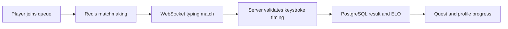

<div align="center">
  

  <a href="https://readme-typing-svg.demolab.com"></a>

  <p>
    <a href="https://www.typelo.tech/"></a>
    
    
    <a href="LICENSE"></a>
  </p>
</div>

## ⌨️ What it is

Typelo turns a typing test into a head-to-head game. Players enter ranked matches, build an ELO rating, and progress through quests and unlockable cosmetics. The browser client is React + TypeScript; the API and matchmaking services are Python/FastAPI.

## 🧭 Match flow



## ✨ In the code

- Ranked queue and match coordination backed by Redis.
- Realtime match updates over WebSockets.
- Server-side checks use submitted keystroke timing; the browser is not the source of truth for the final match result.
- ELO ratings, quests, friend features and cosmetic unlock flows.
- PWA support in the frontend.

## 🧰 Stack

| Part | Tools |
|---|---|
| Web client | React 18, TypeScript, Vite, Zustand, Framer Motion |
| API | Python, FastAPI, Pydantic |
| Matchmaking | Redis, WebSockets |
| Persistence | PostgreSQL |
| Tests | Vitest / Testing Library / Playwright in the frontend; Python tests in `Backend/` |

## 🚀 Run locally

```bash
git clone https://github.com/ChristopherJoshy/typelo.git
cd typelo

# Backend
python -m venv .venv
# Windows: .venv\Scripts\Activate.ps1
# macOS/Linux: source .venv/bin/activate
pip install -r Backend/requirements.txt
uvicorn app.main:app --app-dir Backend --reload
```

In another terminal, configure the frontend's `.env` from `frontend/.env.example`, then:

```bash
cd frontend
npm ci
npm run dev
```

Redis and PostgreSQL are needed for the complete ranked flow. Configure their URLs, Firebase values, and other secrets in local environment files; never commit real credentials.

## 🗂️ Layout

```text
Backend/   FastAPI app, matchmaking, persistence, scripts
frontend/  React client, tests, PWA assets
```

## 📄 License

MIT. See [`LICENSE`](LICENSE).