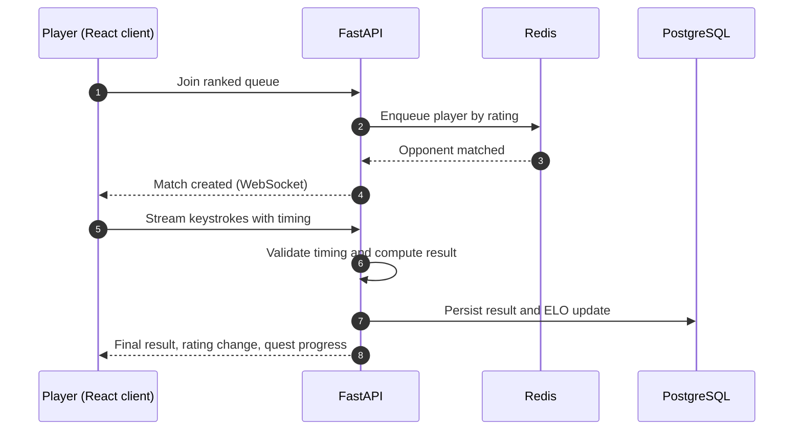

<div align="center">

# Typelo

**Ranked typing duels. Fast fingers, fair matches.**

Head-to-head typing matches with ELO matchmaking, server-validated results, quests, and unlockable cosmetics.

<br />

[](https://www.typelo.tech/)

[](https://react.dev/)
[](https://www.typescriptlang.org/)
[](https://fastapi.tiangolo.com/)
[](https://redis.io/)
[](https://www.postgresql.org/)
[](LICENSE)

[Live Demo](https://www.typelo.tech/) · [Architecture](#architecture) · [Getting Started](#getting-started) · [Project Structure](#project-structure)

</div>

---

## Overview

Typelo turns the classic typing test into a competitive, head-to-head game. Players queue for ranked matches, climb an ELO ladder, complete quests, and unlock cosmetics as they progress.

The browser client is built with React and TypeScript. The API and matchmaking services run on Python and FastAPI, with Redis coordinating live queues and PostgreSQL storing durable results.

## Features

| | |
|---|---|
| **Ranked matchmaking** | Redis-backed queue and match coordination that pairs players by rating. |
| **Realtime duels** | Live opponent progress streamed over WebSockets. |
| **Server-authoritative results** | Final outcomes are computed on the server from submitted keystroke timing, so the browser is never the source of truth. |
| **ELO rating system** | Ratings update after every ranked match and persist in PostgreSQL. |
| **Quests and progression** | Goals and rewards that keep each session meaningful. |
| **Cosmetic unlocks** | Earn and equip cosmetics through play. |
| **Friends** | Social features built around the competitive loop. |
| **Installable PWA** | Add Typelo to your home screen or desktop for an app-like experience. |

## Architecture



**Design principle:** the client renders and reports; the server decides. Keystroke timing is submitted to the API and validated there before any result or rating change is recorded.

## Tech Stack

| Layer | Technologies |
|---|---|
| **Web client** | React 18, TypeScript, Vite, Zustand, Framer Motion |
| **API** | Python, FastAPI, Pydantic |
| **Matchmaking** | Redis, WebSockets |
| **Persistence** | PostgreSQL |
| **Auth** | Firebase |
| **Testing** | Vitest, Testing Library, Playwright (frontend); Python tests (`Backend/`) |

## Getting Started

### Prerequisites

- Python 3.10+
- Node.js 18+
- Redis and PostgreSQL (required for the complete ranked flow)
- A Firebase project for authentication

### 1. Clone the repository

```bash
git clone https://github.com/ChristopherJoshy/Typelo.git
cd Typelo
```

### 2. Start the backend

<details open>
<summary><b>Windows (PowerShell)</b></summary>

```powershell
python -m venv .venv
.venv\Scripts\Activate.ps1
pip install -r Backend/requirements.txt
uvicorn app.main:app --app-dir Backend --reload
```

</details>

<details>
<summary><b>macOS / Linux</b></summary>

```bash
python -m venv .venv
source .venv/bin/activate
pip install -r Backend/requirements.txt
uvicorn app.main:app --app-dir Backend --reload
```

</details>

### 3. Start the frontend

In a second terminal:

```bash
cd frontend
cp .env.example .env    # Windows: copy .env.example .env
npm ci
npm run dev
```

Fill in `.env` with your API URL, Firebase values, and any other required settings.

> **Security:** keep Redis and PostgreSQL URLs, Firebase credentials, and all other secrets in local environment files. Never commit real credentials.

## Testing

```bash
# Frontend
cd frontend
npm test              # unit and component tests (Vitest)
npx playwright test   # end-to-end tests

# Backend
cd Backend
pytest
```

## Project Structure

```text
Typelo/
├── Backend/     FastAPI app, matchmaking, persistence, scripts
└── frontend/    React client, tests, PWA assets
```

## Contributing

Issues and pull requests are welcome. For larger changes, please open an issue first to discuss what you would like to change.

1. Fork the repository
2. Create a feature branch: `git checkout -b feature/your-feature`
3. Commit your changes and push the branch
4. Open a pull request

## License

Released under the [MIT License](LICENSE).

<div align="center">
<br />

Built by [Christopher Joshy](https://github.com/ChristopherJoshy)

</div>
